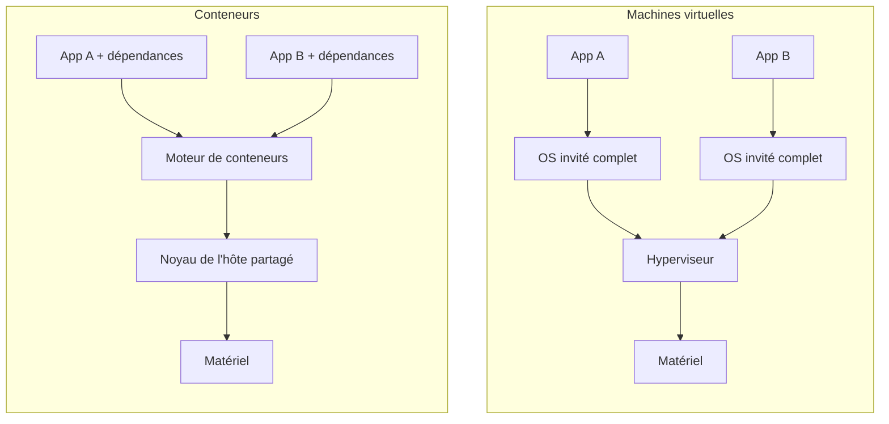
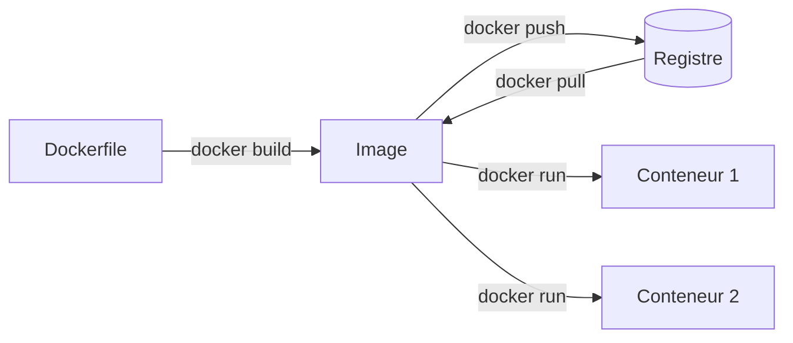
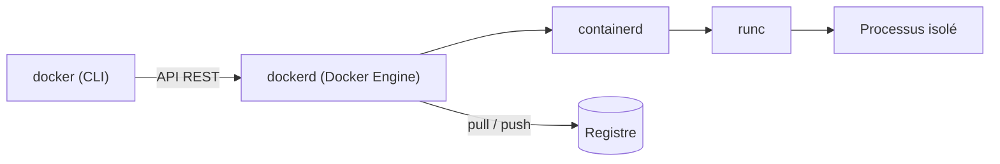

[Sommaire](Readme.md) · [Chapitre suivant →](02-Installer-Docker.md)

# Pourquoi Docker ?

## 🎯 Objectifs

À la fin de ce chapitre, vous saurez :

1. Expliquer le problème que résout Docker.
2. Distinguer un conteneur d'une machine virtuelle.
3. Nommer les objets manipulés par Docker et les composants qui le font tourner.

---

## 1. Le problème : « ça marche sur ma machine »

Une application ne se résume pas à son code. Elle dépend d'un interpréteur ou d'un runtime dans une version précise, de bibliothèques système, de variables d'environnement, de fichiers de configuration, parfois d'une base de données. Chaque poste, chaque serveur de CI et chaque serveur de production a sa propre combinaison de ces éléments. Les écarts entre ces combinaisons produisent les bugs les plus coûteux à diagnostiquer : ceux qu'on ne reproduit pas.

Docker répond en **empaquetant l'application avec tout ce dont elle a besoin pour tourner** dans un artefact unique, l'**image**. Cette image s'exécute de la même façon partout où Docker est installé.

---

## 2. Conteneur ou machine virtuelle ?

Une **machine virtuelle** émule un ordinateur complet : un hyperviseur fait tourner un système d'exploitation invité entier, avec son propre noyau. C'est une isolation forte, mais lourde : plusieurs gigaoctets, un démarrage qui se compte en dizaines de secondes.

Un **conteneur** est un simple **processus** de la machine hôte, isolé par des fonctions du noyau Linux :

- les **namespaces** limitent ce que le processus voit (ses propres processus, son propre réseau, son propre système de fichiers…) ;
- les **cgroups** limitent ce qu'il consomme (CPU, mémoire, entrées/sorties).

Tous les conteneurs partagent le noyau de l'hôte. Ils pèsent quelques mégaoctets et démarrent en une fraction de seconde.

| | Machine virtuelle | Conteneur |
|---|---|---|
| Ce qui est isolé | un système complet | un processus |
| Noyau | un par VM | partagé avec l'hôte |
| Taille typique | Go | Mo |
| Démarrage | dizaines de secondes | moins d'une seconde |
| Isolation | forte (matérielle) | bonne, mais noyau commun |

> Les deux ne s'opposent pas : en production, les conteneurs tournent très souvent… dans des VM.

### Et sur Windows ou macOS ?

Les conteneurs Linux ont besoin d'un noyau Linux. Sur Windows et macOS, **Docker Desktop** fait donc tourner une petite VM Linux, gérée pour vous (WSL 2 sous Windows, le framework de virtualisation d'Apple sous macOS). C'est transparent à l'usage, mais cela explique les réglages de mémoire et de disque de Docker Desktop, et les performances parfois moindres sur les fichiers partagés avec l'hôte.

---

## 3. Le vocabulaire

| Terme | Définition | Analogie |
|---|---|---|
| **Image** | modèle en lecture seule : un système de fichiers en couches plus des métadonnées (commande de démarrage, ports, variables…) | une classe |
| **Conteneur** | instance en cours d'exécution d'une image, avec une couche inscriptible éphémère | un objet |
| **Dockerfile** | fichier texte qui décrit comment construire une image, étape par étape | une recette |
| **Registre** | serveur qui stocke et distribue des images ; Docker Hub est le registre par défaut | un dépôt de paquets |
| **Tag** | étiquette qui désigne une version d'une image : `nginx:1.30-alpine` | un numéro de version |
| **Volume** | espace de stockage géré par Docker, qui survit à la suppression du conteneur | un disque externe |
| **Réseau** | réseau virtuel sur lequel des conteneurs communiquent | un switch |

Une image se lance autant de fois qu'on veut : chaque `docker run` crée un nouveau conteneur indépendant.

---

## 4. Ce qui tourne sous le capot

« Docker » désigne en réalité plusieurs composants qui se parlent :

- **`docker`**, la ligne de commande, n'exécute rien elle-même : elle envoie des requêtes à l'API du démon.
- **`dockerd`**, le Docker Engine, gère images, conteneurs, volumes et réseaux.
- **containerd** pilote le cycle de vie des conteneurs ; **runc** les crée concrètement à partir des namespaces et cgroups.

Les images et l'exécution suivent les standards de l'**Open Container Initiative (OCI)**. Une image construite avec Docker tourne donc aussi avec Podman, containerd seul ou Kubernetes.

---

## 5. Vérifier ses acquis

Voir les réponses

1. *Un conteneur embarque-t-il un noyau ?* Non : il partage celui de l'hôte. C'est ce qui le rend léger.
2. *Quelle est la différence entre une image et un conteneur ?* L'image est un modèle en lecture seule ; le conteneur est une instance en cours d'exécution de cette image.
3. *Pourquoi Docker Desktop installe-t-il une VM sur macOS ?* Parce que les conteneurs Linux ont besoin d'un noyau Linux, absent de macOS.
4. *Qui exécute réellement le conteneur quand on tape `docker run` ?* La CLI appelle `dockerd`, qui délègue à containerd, qui utilise runc.

---

[Sommaire](Readme.md) · [Chapitre suivant →](02-Installer-Docker.md)
