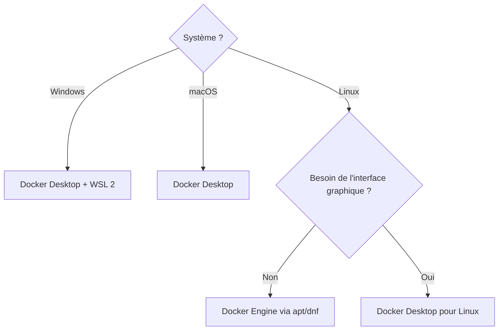

[← Chapitre précédent](01-Pourquoi-Docker.md) · [Sommaire](Readme.md) · [Chapitre suivant →](03-Premiers-conteneurs.md)

# Installer Docker

## 🎯 Objectifs

À la fin de ce chapitre, vous aurez :

1. Choisi entre Docker Desktop et Docker Engine selon votre système et votre contexte.
2. Installé Docker sur votre machine.
3. Vérifié que le client, le moteur et Compose répondent.

> Les procédures ci-dessous suivent la documentation officielle à la date du 5 octobre 2026. En cas de doute, c'est elle qui fait foi : [docs.docker.com/get-started/get-docker](https://docs.docker.com/get-started/get-docker/).

---

## 1. Desktop ou Engine ?

| | Docker Desktop | Docker Engine |
|---|---|---|
| Systèmes | Windows, macOS, Linux | Linux uniquement |
| Contenu | moteur, CLI, Compose, Buildx, interface graphique, VM Linux intégrée, Kubernetes optionnel | moteur, CLI, plugins Compose et Buildx |
| Licence | gratuite sous conditions (voir ci-dessous) | open source (Apache 2.0) |
| Usage type | poste de développement | serveurs, CI, poste Linux |



### La licence de Docker Desktop

Docker Desktop est gratuit pour un usage personnel, l'enseignement, les projets open source non commerciaux et les **petites entreprises** (moins de 250 salariés **et** moins de 10 millions de dollars de chiffre d'affaires annuel). Au-delà, ainsi que pour les administrations, un abonnement payant (Pro, Team ou Business) est requis. Docker Engine sous Linux n'est pas concerné.

> Avant d'installer Docker Desktop sur un poste professionnel, vérifiez que votre organisation dispose de la licence adéquate.

---

## 2. Windows : Docker Desktop avec WSL 2

### Prérequis

- Windows 10 64 bits version 22H2 (build 19045), ou Windows 11 64 bits version 23H2 (build 22631) ou ultérieure ; éditions Pro, Entreprise ou Éducation.
- WSL en version **2.1.5 ou plus**.
- Processeur 64 bits avec SLAT, **8 Go de RAM**, virtualisation activée dans le BIOS/UEFI.
- Le service Windows « Serveur » (LanmanServer) activé en démarrage automatique.

### Étape 1 — Installer ou mettre à jour WSL

Dans un PowerShell **lancé en administrateur** :

```powershell
wsl --version   # si rien ne s'affiche, la version de WSL est trop ancienne
wsl --install   # première installation
wsl --update    # mise à jour d'une installation existante
```

Redémarrez si Windows le demande.

### Étape 2 — Installer Docker Desktop

1. Téléchargez `Docker Desktop Installer.exe` depuis [docs.docker.com/desktop/setup/install/windows-install](https://docs.docker.com/desktop/setup/install/windows-install/).
2. Lancez-le et choisissez l'installation **par utilisateur** (proposée par défaut) : elle ne demande pas de droits administrateur, ni pour installer ni pour mettre à jour.
3. Sur la page de configuration, gardez **WSL 2** comme moteur.
4. À la fin, cliquez sur **Close**.

En ligne de commande, l'équivalent est :

```powershell
Start-Process 'Docker Desktop Installer.exe' -Wait -ArgumentList 'install', '--user'
```

> L'installation « pour tous les utilisateurs » (droits administrateur) n'est nécessaire que pour les **conteneurs Windows** ou le moteur Hyper-V. Ce cours n'utilise que des conteneurs Linux.

### Étape 3 — Premier démarrage

Docker Desktop ne démarre pas tout seul après l'installation. Lancez-le depuis le menu Démarrer, acceptez les conditions d'utilisation, puis attendez que l'icône de la baleine indique que le moteur tourne.

---

## 3. macOS : Docker Desktop

### Prérequis

- Une version de macOS **supportée** : la version majeure actuelle et les deux précédentes.
- Le bon installeur selon le processeur : **Apple silicon** (M1 et suivants) ou **Intel**. Menu Apple → « À propos de ce Mac » pour vérifier.

### Installation

1. Téléchargez `Docker.dmg` depuis [docs.docker.com/desktop/setup/install/mac-install](https://docs.docker.com/desktop/setup/install/mac-install/).
2. Ouvrez-le et glissez **Docker** dans **Applications**.
3. Lancez Docker depuis Applications, acceptez les conditions et autorisez les permissions demandées.

En ligne de commande, depuis le dossier où se trouve `Docker.dmg` :

```bash
sudo hdiutil attach Docker.dmg
sudo /Volumes/Docker/Docker.app/Contents/MacOS/install
sudo hdiutil detach /Volumes/Docker
```

---

## 4. Linux (Ubuntu) : Docker Engine

On installe ici Docker Engine depuis le dépôt `apt` officiel de Docker, sur Ubuntu **26.04, 24.04 ou 22.04 LTS** en 64 bits. Pour Debian, Fedora ou RHEL, la logique est la même : voir [docs.docker.com/engine/install](https://docs.docker.com/engine/install/).

> **Pare-feu.** Les ports publiés par Docker contournent les règles `ufw` et `firewalld`. Sur une machine exposée, publiez vos ports sur `127.0.0.1` (voir chapitre 05) ou filtrez dans la chaîne `DOCKER-USER`.

### Étape 1 — Retirer les paquets non officiels

Les paquets fournis par la distribution (`docker.io`, `docker-compose`…) entrent en conflit avec les paquets officiels :

```bash
sudo apt remove $(dpkg --get-selections docker.io docker-compose docker-compose-v2 docker-doc docker-buildx podman-docker containerd runc | cut -f1)
```

`apt` peut répondre qu'aucun de ces paquets n'est installé : c'est normal.

### Étape 2 — Ajouter le dépôt Docker

```bash
# Clé GPG officielle de Docker
sudo apt update
sudo apt install ca-certificates curl
sudo install -m 0755 -d /etc/apt/keyrings
sudo curl -fsSL https://download.docker.com/linux/ubuntu/gpg -o /etc/apt/keyrings/docker.asc
sudo chmod a+r /etc/apt/keyrings/docker.asc

# Déclaration du dépôt (format deb822)
sudo tee /etc/apt/sources.list.d/docker.sources <<SOURCES
Types: deb
URIs: https://download.docker.com/linux/ubuntu
Suites: $(. /etc/os-release && echo "${UBUNTU_CODENAME:-$VERSION_CODENAME}")
Components: stable
Architectures: $(dpkg --print-architecture)
Signed-By: /etc/apt/keyrings/docker.asc
SOURCES

sudo apt update
```

### Étape 3 — Installer les paquets

```bash
sudo apt install docker-ce docker-ce-cli containerd.io docker-buildx-plugin docker-compose-plugin
sudo systemctl status docker   # doit afficher « active (running) »
sudo docker run --rm hello-world
```

### Étape 4 — Utiliser Docker sans `sudo`

```bash
sudo groupadd docker            # le groupe existe souvent déjà : l'erreur est alors sans conséquence
sudo usermod -aG docker "$USER"
newgrp docker                   # ou se déconnecter / reconnecter
docker run --rm hello-world
```

> ⚠️ Appartenir au groupe `docker` revient à avoir les droits **root** sur la machine : n'y ajoutez que des utilisateurs de confiance. Pour un isolement plus fort, Docker propose un [mode rootless](https://docs.docker.com/engine/security/rootless/).

---

## 5. Vérifier l'installation

Quelle que soit la plateforme, ces quatre commandes doivent répondre sans erreur :

```bash
docker version            # versions du client ET du serveur (Engine)
docker info               # état du moteur : conteneurs, images, stockage…
docker compose version    # plugin Compose (v5.x à date)
docker run --rm hello-world
```

`docker version` affiche deux blocs, **Client** et **Server**. Si seul le bloc Client apparaît, la CLI est installée mais ne joint pas le moteur.

---

## 6. Dépannage

| Symptôme | Cause probable | Solution |
|---|---|---|
| `Cannot connect to the Docker daemon` | moteur arrêté | lancer Docker Desktop ; sous Linux `sudo systemctl start docker` |
| `permission denied … /var/run/docker.sock` | utilisateur hors du groupe `docker` | étape 4 de la section Linux, puis se reconnecter |
| Docker Desktop bloqué sur « Starting » (Windows) | WSL absent ou trop ancien | `wsl --update`, puis redémarrer Docker Desktop |
| « Virtualization support not detected » | virtualisation désactivée | l'activer dans le BIOS/UEFI (Intel VT-x / AMD-V) |
| `toomanyrequests` au téléchargement d'images | limite de téléchargement anonyme de Docker Hub | `docker login` avec un compte Docker gratuit |

---

## 7. À vous de jouer

Installez Docker sur votre machine, puis exécutez les quatre commandes de la section 5.

<details>
<summary>Voir le résultat attendu</summary>

- `docker version` affiche un bloc **Client** et un bloc **Server**, tous deux en version 29.x (ou plus récente).
- `docker compose version` affiche `Docker Compose version v5.x.x` (ou plus récente).
- `docker run --rm hello-world` affiche un message commençant par « Hello from Docker! », qui détaille les quatre étapes réalisées : le client a contacté le démon, le démon a téléchargé l'image, créé le conteneur, puis renvoyé sa sortie au client.

</details>

---

[← Chapitre précédent](01-Pourquoi-Docker.md) · [Sommaire](Readme.md) · [Chapitre suivant →](03-Premiers-conteneurs.md)
