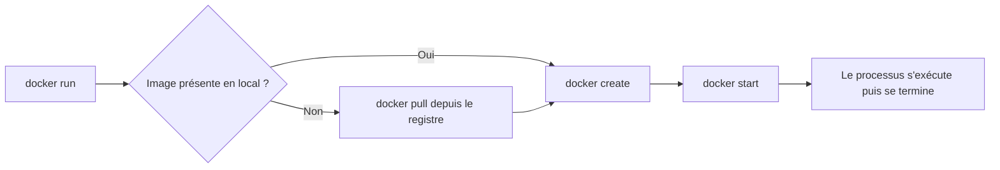
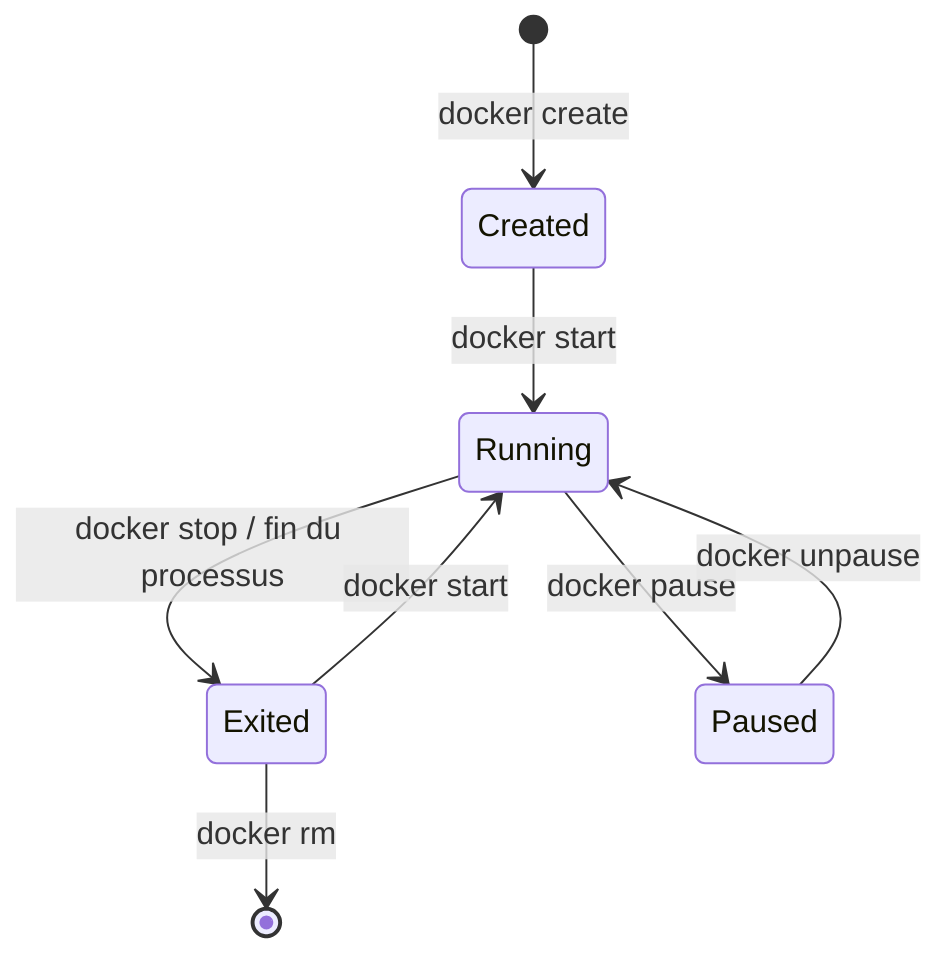

[← Chapitre précédent](02-Installer-Docker.md) · [Sommaire](Readme.md) · [Chapitre suivant →](04-Construire-une-image.md)

# Premiers conteneurs

## 🎯 Objectifs

À la fin de ce chapitre, vous saurez :

1. Lire le nom complet d'une image et choisir un tag.
2. Lancer un conteneur en premier plan, en arrière-plan et en interactif.
3. Publier un port, lire les journaux, entrer dans un conteneur.
4. Arrêter, redémarrer, supprimer, et faire le ménage.

---

## 1. Ce que fait `docker run`

```bash
docker run --rm hello-world
```

Cette seule commande enchaîne quatre opérations :



L'option `--rm` supprime le conteneur dès qu'il s'arrête : pratique pour les essais, cela évite d'accumuler des conteneurs arrêtés.

---

## 2. Nommer une image

Le nom complet d'une image se lit ainsi :

```text
[registre/][espace/]nom[:tag][@digest]

nginx:1.30-alpine              → docker.io/library/nginx:1.30-alpine
ghcr.io/mon-org/mon-app:2.3.1  → registre GitHub, espace « mon-org »
```

- Sans registre, Docker utilise **Docker Hub** (`docker.io`) ; les **images officielles** y sont rangées dans l'espace `library`.
- Sans tag, Docker utilise `latest`, qui ne désigne **pas** forcément la dernière version : c'est une étiquette comme une autre, déplacée au bon vouloir de l'éditeur.
- Le **digest** (`@sha256:…`) désigne un contenu exact et immuable.

> Bonne pratique : **toujours préciser un tag**, au moins la version majeure. Le tag `1.30-alpine` reste sur la branche stable 1.30 de nginx et reçoit ses correctifs ; `latest` peut changer de version majeure du jour au lendemain.

```bash
docker pull nginx:1.30-alpine
docker image ls
```

---

## 3. Un serveur web en arrière-plan

```bash
docker run -d --name web -p 8080:80 nginx:1.30-alpine
```

| Option | Rôle |
|---|---|
| `-d` | *detached* : rend la main immédiatement, le conteneur tourne en arrière-plan |
| `--name web` | nom lisible ; sinon Docker en tire un au hasard |
| `-p 8080:80` | publie le port **80 du conteneur** sur le port **8080 de l'hôte** (`hôte:conteneur`) |

Ouvrez [http://localhost:8080](http://localhost:8080) : la page d'accueil de nginx s'affiche.

### Observer

```bash
docker ps              # conteneurs en cours d'exécution
docker ps -a           # tous, y compris arrêtés
docker logs web        # sortie standard du conteneur
docker logs -f web     # suivre en continu (Ctrl+C pour quitter, le conteneur continue)
docker stats --no-stream   # consommation CPU et mémoire
docker inspect web     # toute la configuration, en JSON
```

### Entrer dans le conteneur

```bash
docker exec -it web sh
```

`exec` lance un **second processus** dans un conteneur qui tourne déjà ; `-it` le rend interactif avec un terminal. Les images basées sur Alpine fournissent `sh`, pas `bash`. Tapez `exit` pour sortir : le conteneur, lui, continue de tourner.

---

## 4. Un conteneur interactif et jetable

```bash
docker run --rm -it ubuntu:26.04 bash
```

Vous êtes dans un shell Ubuntu 26.04, quel que soit votre système hôte. Essayez `cat /etc/os-release`, puis `exit` : le conteneur s'arrête et `--rm` le supprime.

On passe des variables d'environnement avec `-e` :

```bash
docker run --rm -e MESSAGE=bonjour ubuntu:26.04 sh -c 'echo "$MESSAGE"'
```

---

## 5. Le cycle de vie d'un conteneur



```bash
docker stop web        # envoie SIGTERM, puis SIGKILL après 10 s
docker start web       # redémarre le même conteneur, avec sa configuration
docker rm web          # supprime un conteneur arrêté
docker rm -f web       # arrête et supprime en une fois
```

> Un conteneur vit **tant que son processus principal vit**. Si la commande se termine, le conteneur passe à l'état `Exited`. C'est pour cela que `hello-world` s'arrête aussitôt alors que nginx reste actif.

---

## 6. Faire le ménage

Images et conteneurs arrêtés s'accumulent vite.

```bash
docker system df           # espace occupé, par catégorie
docker container prune     # supprime les conteneurs arrêtés
docker image prune         # supprime les images sans tag (« dangling »)
docker system prune        # les deux, plus les réseaux inutilisés et le cache de build
```

> `docker system prune` ne touche pas aux volumes sauf avec `--volumes`. Lisez toujours la confirmation avant de valider.

---

## 7. Exercice

1. Lancez un conteneur `nginx:1.30-alpine` nommé `exo`, en arrière-plan, publié sur le port **8081** de l'hôte.
2. Vérifiez qu'il répond dans le navigateur et qu'une ligne apparaît dans ses journaux à chaque rechargement.
3. Remplacez la page d'accueil par « Bonjour Docker » **depuis l'intérieur** du conteneur. Le fichier servi est `/usr/share/nginx/html/index.html`.
4. Supprimez le conteneur, recréez-le avec la même commande : la modification a-t-elle survécu ? Pourquoi ?

<details>
<summary>Voir la correction</summary>

```bash
# 1
docker run -d --name exo -p 8081:80 nginx:1.30-alpine

# 2 : ouvrir http://localhost:8081 puis
docker logs -f exo

# 3
docker exec exo sh -c 'echo "Bonjour Docker" > /usr/share/nginx/html/index.html'

# 4
docker rm -f exo
docker run -d --name exo -p 8081:80 nginx:1.30-alpine
```

La modification a disparu : elle était écrite dans la **couche inscriptible** du conteneur, détruite avec lui. Le nouveau conteneur repart de l'image, intacte. Pour qu'un changement soit durable, il faut soit le mettre **dans l'image** (chapitre 04), soit le stocker **dans un volume** (chapitre 05).

```bash
docker rm -f exo   # nettoyage
```

</details>

---

[← Chapitre précédent](02-Installer-Docker.md) · [Sommaire](Readme.md) · [Chapitre suivant →](04-Construire-une-image.md)
