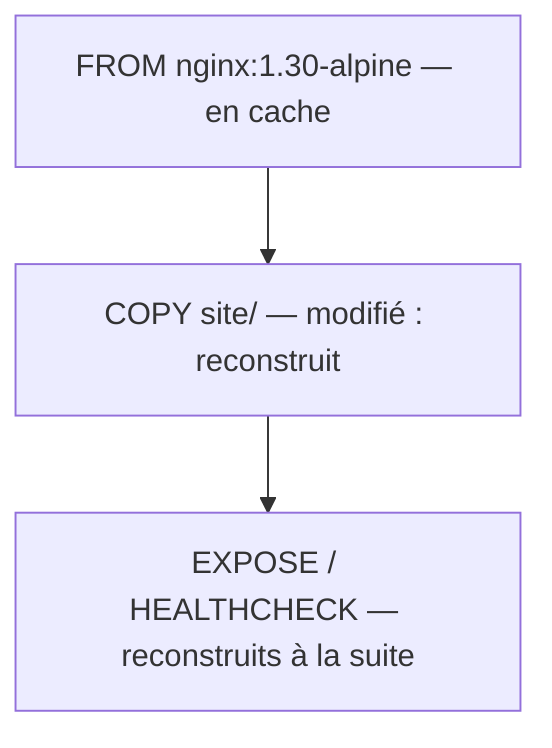

[← Chapitre précédent](03-Premiers-conteneurs.md) · [Sommaire](Readme.md) · [Chapitre suivant →](05-Volumes-et-reseaux.md)

# Construire une image

## 🎯 Objectifs

À la fin de ce chapitre, vous saurez :

1. Écrire un `Dockerfile` avec les instructions essentielles.
2. Construire, étiqueter et lancer votre propre image.
3. Tirer parti du cache de construction.
4. Appliquer les bonnes pratiques de base.

---

## 1. Le projet

On conteneurise un petit site statique. Créez un dossier de travail avec cette arborescence (elle se trouve aussi dans le dossier `demo/` du dépôt) :

```text
mon-site/
├── Dockerfile
├── .dockerignore
└── site/
    └── index.html
```

`site/index.html` peut contenir n'importe quelle page HTML, par exemple :

```html
<!doctype html>
<html lang="fr">
<head>
  <meta charset="utf-8">
  <title>Docker 101</title>
</head>
<body>
  <h1>Bonjour depuis un conteneur 🐳</h1>
</body>
</html>
```

---

## 2. Le Dockerfile

```dockerfile
# syntax=docker/dockerfile:1

# Image de base officielle, version épinglée (branche stable de nginx, variante Alpine)
FROM nginx:1.30-alpine

# Le contenu du site : ce qui change le plus souvent vient en dernier
COPY site/ /usr/share/nginx/html/

# Documente le port écouté (ne publie rien à lui seul)
EXPOSE 80

# Docker vérifie régulièrement que le serveur répond
HEALTHCHECK --interval=30s --timeout=3s --start-period=5s --retries=3 \
  CMD ["wget", "-q", "-O", "/dev/null", "http://127.0.0.1/"]
```

- La première ligne demande la dernière syntaxe stable du langage Dockerfile (version 1.x).
- On ne précise pas de commande de démarrage : l'image nginx en définit déjà une, que notre image hérite.

### Les instructions à connaître

| Instruction | Rôle |
|---|---|
| `FROM` | image de départ ; toujours la première instruction |
| `WORKDIR` | répertoire de travail des instructions suivantes (le crée si besoin) |
| `COPY` | copie des fichiers du contexte de build vers l'image |
| `RUN` | exécute une commande **pendant la construction** (installer un paquet…) |
| `ENV` | définit une variable d'environnement, dans l'image et à l'exécution |
| `ARG` | variable disponible **seulement pendant la construction** |
| `EXPOSE` | documente un port ; c'est `-p` qui le publie réellement |
| `USER` | utilisateur sous lequel tournent les instructions suivantes et le conteneur |
| `CMD` | commande lancée par défaut au démarrage du conteneur ; remplaçable dans `docker run` |
| `ENTRYPOINT` | exécutable principal ; `CMD` lui fournit alors ses arguments par défaut |
| `HEALTHCHECK` | commande de vérification de santé du conteneur |

> `RUN` agit à la **construction**, `CMD` et `ENTRYPOINT` au **démarrage**. Confondre les deux est l'erreur la plus fréquente.

---

## 3. Construire et lancer

Depuis le dossier `mon-site/` :

```bash
docker build -t mon-site:1.0 .
docker image ls mon-site
docker run -d --name site -p 8080:80 mon-site:1.0
```

- `-t mon-site:1.0` donne un nom et un tag à l'image produite.
- Le `.` final désigne le **contexte de build** : le dossier dont le contenu est envoyé au moteur et dans lequel `COPY` va chercher ses fichiers.

Ouvrez [http://localhost:8080](http://localhost:8080). Au bout de quelques secondes, `docker ps` affiche `(healthy)` dans la colonne STATUS.

---

## 4. Les couches et le cache

Chaque instruction qui modifie le système de fichiers (`COPY`, `RUN`…) produit une **couche**. Les couches sont empilées, partagées entre images et **mises en cache** :

```bash
docker history mon-site:1.0
```

À la reconstruction, Docker réutilise toutes les couches jusqu'à la première instruction dont l'entrée a changé ; il reconstruit **celle-ci et toutes les suivantes**.



D'où la règle : **ordonner les instructions de la moins changeante à la plus changeante**. Dans une application Node ou Python, on copie d'abord le fichier de dépendances, on les installe, et on copie le code source **ensuite** : modifier le code ne relance pas l'installation.

```dockerfile
# Exemple de principe, application Node.js
COPY package.json package-lock.json ./
RUN npm ci
COPY . .
```

---

## 5. Le fichier `.dockerignore`

Tout le contexte de build est envoyé au moteur. Un fichier `.dockerignore`, à la racine du contexte, en exclut ce qui est inutile ou sensible :

```text
.git
.env
.env.*
node_modules
compose.yaml
Dockerfile
.dockerignore
```

Le build est plus rapide, l'image plus petite, et aucun secret local n'y atterrit par accident.

---

## 6. Bonnes pratiques

- **Partir d'une image officielle et légère**, à une **version épinglée** : `nginx:1.30-alpine` plutôt que `nginx` ou `nginx:latest`.
- **Un processus principal par conteneur** : le site d'un côté, la base de données de l'autre.
- **Aucun secret dans l'image** : ni mot de passe dans un `ENV`, ni fichier `.env` copié. Les secrets se passent à l'exécution (variables, fichiers montés) ou via les *build secrets* de BuildKit.
- **Ne pas tourner en root** quand c'est possible : instruction `USER`, ou image prévue pour (par exemple `nginxinc/nginx-unprivileged`, qui écoute sur le port 8080).
- **Faire vérifier son Dockerfile** : `docker build --check .` signale les écarts aux bonnes pratiques sans construire l'image.
- **Construction multi-étapes** pour les langages compilés : une étape compile, une autre ne contient que le résultat. Voir [docs.docker.com/build/building/multi-stage](https://docs.docker.com/build/building/multi-stage/).

---

## 7. Partager son image

Une image se publie sur un registre. Avec un compte Docker Hub (gratuit) :

```bash
docker login
docker tag mon-site:1.0 <votre-identifiant>/mon-site:1.0
docker push <votre-identifiant>/mon-site:1.0
```

N'importe quelle machine peut ensuite la lancer avec `docker run <votre-identifiant>/mon-site:1.0`.

---

## 8. Exercice

1. Construisez `mon-site:1.0` et lancez-le, comme en section 3.
2. Modifiez le titre de `site/index.html`, puis construisez `mon-site:1.1`. Observez la sortie du build : quelles étapes sont marquées `CACHED` ?
3. Remplacez le conteneur `site` par un conteneur basé sur `mon-site:1.1`.
4. Lancez `docker build --check .` : le Dockerfile est-il conforme ?

<details>
<summary>Voir la correction</summary>

```bash
# 1
docker build -t mon-site:1.0 .
docker run -d --name site -p 8080:80 mon-site:1.0

# 2 : après modification de site/index.html
docker build -t mon-site:1.1 .
```

L'étape `FROM` est marquée `CACHED` ; `COPY site/` est rejouée, puisque son entrée a changé, ainsi que tout ce qui la suit.

```bash
# 3
docker rm -f site
docker run -d --name site -p 8080:80 mon-site:1.1

# 4
docker build --check .
```

Sur ce Dockerfile, la vérification ne devrait remonter aucun avertissement ; sinon, chaque avertissement renvoie vers la règle documentée qu'il enfreint. Les deux images coexistent (`docker image ls mon-site`) : revenir à la 1.0 ne demande qu'un `docker run` sur l'ancien tag. C'est l'intérêt de **versionner** ses images plutôt que d'écraser `latest`.

</details>

---

[← Chapitre précédent](03-Premiers-conteneurs.md) · [Sommaire](Readme.md) · [Chapitre suivant →](05-Volumes-et-reseaux.md)
