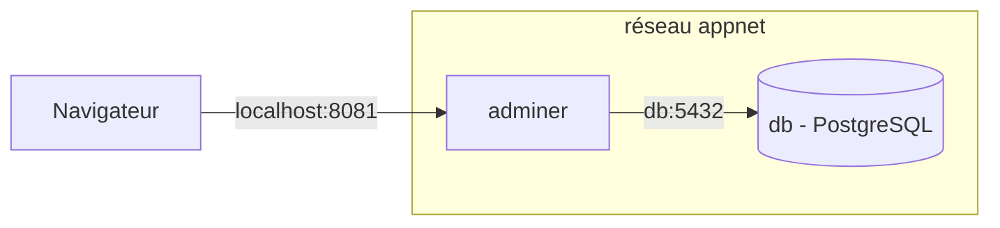

[← Chapitre précédent](04-Construire-une-image.md) · [Sommaire](Readme.md) · [Chapitre suivant →](06-Docker-Compose.md)

# Volumes et réseaux

## 🎯 Objectifs

À la fin de ce chapitre, vous saurez :

1. Choisir entre volume nommé, montage de dossier et `tmpfs`.
2. Faire survivre les données d'une base à la suppression de son conteneur.
3. Faire communiquer deux conteneurs par leur nom sur un réseau dédié.

---

## 1. Les données d'un conteneur sont éphémères

L'exercice du chapitre 03 l'a montré : ce qu'un conteneur écrit dans sa couche inscriptible disparaît avec lui. Pour garder des données, on **monte** un stockage externe dans son système de fichiers.

| Type | Syntaxe courte | Géré par | Usage typique |
|---|---|---|---|
| Volume nommé | `-v pgdata:/chemin` | Docker | données d'une base, persistance en général |
| Montage de dossier (*bind mount*) | `-v ./site:/chemin` | vous (dossier de l'hôte) | code source en développement, fichiers de configuration |
| `tmpfs` | `--tmpfs /chemin` | mémoire vive | données temporaires ou sensibles, jamais écrites sur disque |

> Préférez les **volumes nommés** pour les données : Docker les gère, ils sont portables d'une plateforme à l'autre et plus rapides que les dossiers partagés sous Windows et macOS.

---

## 2. Une base PostgreSQL persistante

```bash
docker volume create pgdata
docker run -d --name db \
  -e POSTGRES_PASSWORD=change-me \
  -v pgdata:/var/lib/postgresql \
  postgres:18-alpine
```

> ⚠️ **Changement de PostgreSQL 18.** À partir de la version 18, l'image officielle stocke ses données dans `/var/lib/postgresql/18/docker` et déclare son volume sur `/var/lib/postgresql`. C'est donc **`/var/lib/postgresql`** qu'il faut monter. Les nombreux tutoriels qui montent `/var/lib/postgresql/data` ne valent que pour les versions 17 et antérieures.

Écrivons une donnée, détruisons le conteneur, recréons-le :

```bash
docker exec db psql -U postgres -c "CREATE TABLE t (msg text); INSERT INTO t VALUES ('toujours là');"

docker rm -f db
docker run -d --name db \
  -e POSTGRES_PASSWORD=change-me \
  -v pgdata:/var/lib/postgresql \
  postgres:18-alpine

docker exec db psql -U postgres -c "SELECT * FROM t;"
```

La ligne `toujours là` est revenue : elle vivait dans le volume, pas dans le conteneur. Si la dernière commande échoue, attendez quelques secondes que PostgreSQL ait fini de démarrer.

```bash
docker volume ls
docker volume inspect pgdata
```

---

## 3. Monter un dossier de l'hôte

Pour voir ses modifications **sans reconstruire l'image**, on monte le dossier du site directement dans nginx, en lecture seule (`:ro`) :

```bash
# bash / zsh, depuis le dossier mon-site/
docker run -d --name dev -p 8082:80 -v "$(pwd)/site:/usr/share/nginx/html:ro" nginx:1.30-alpine
```

```powershell
# PowerShell, depuis le dossier mon-site\
docker run -d --name dev -p 8082:80 -v "${PWD}/site:/usr/share/nginx/html:ro" nginx:1.30-alpine
```

Modifiez `site/index.html`, rechargez [http://localhost:8082](http://localhost:8082) : la modification est immédiate. C'est le mode de travail en développement ; en production, on livre une image qui contient le site (chapitre 04).

---

## 4. Les réseaux

Docker crée par défaut un réseau `bridge`. Sur ce réseau par défaut, les conteneurs ne se trouvent **pas** par leur nom. Sur un **réseau créé par vous**, Docker fournit un DNS interne : chaque conteneur est joignable par son nom.



```bash
docker network create appnet
docker network connect appnet db

docker run -d --name adminer --network appnet \
  -p 127.0.0.1:8081:8080 \
  -e ADMINER_DEFAULT_SERVER=db \
  adminer:5
```

Ouvrez [http://localhost:8081](http://localhost:8081) et connectez-vous : système **PostgreSQL**, serveur `db`, utilisateur `postgres`, mot de passe `change-me`. La table `t` est là.

Points à retenir :

- `db` est résolu par le DNS du réseau `appnet` ; aucune adresse IP n'est écrite en dur.
- La base n'a **aucun port publié** : elle n'est joignable que depuis le réseau `appnet`. On ne publie que ce qui doit être atteint depuis l'hôte.
- `-p 127.0.0.1:8081:8080` limite l'accès à la machine locale ; `-p 8081:8080` l'ouvrirait à tout le réseau de l'hôte.

---

## 5. Nettoyage

```bash
docker rm -f adminer db dev
docker network rm appnet
docker volume rm pgdata     # supprime définitivement les données
```

---

## 6. Vérifier ses acquis

<details>
<summary>Voir les réponses</summary>

1. *Je supprime un conteneur PostgreSQL monté sur un volume nommé : que deviennent les données ?* Elles restent dans le volume, réutilisable par un nouveau conteneur. Seul `docker volume rm` (ou `prune` sur les volumes) les supprime.
2. *Pourquoi `adminer` trouve-t-il `db` par son nom ?* Parce que les deux sont sur un réseau créé par l'utilisateur, qui fournit une résolution DNS par nom de conteneur.
3. *Faut-il publier le port 5432 de la base pour qu'adminer s'y connecte ?* Non : la publication ne sert qu'aux accès depuis l'hôte. Entre conteneurs d'un même réseau, tous les ports sont accessibles.

</details>

---

[← Chapitre précédent](04-Construire-une-image.md) · [Sommaire](Readme.md) · [Chapitre suivant →](06-Docker-Compose.md)
