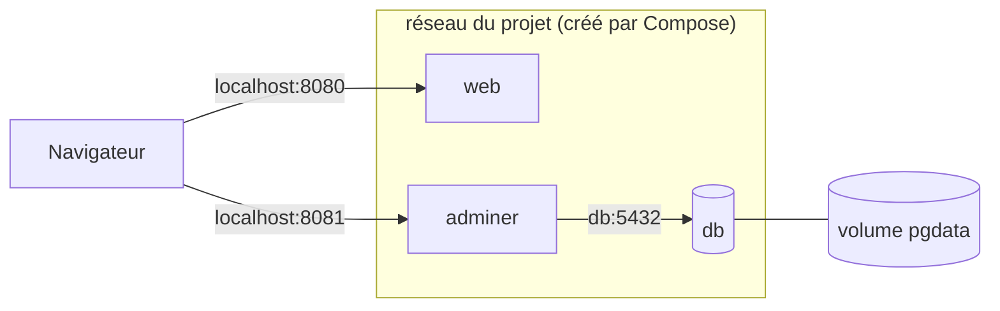

[← Chapitre précédent](05-Volumes-et-reseaux.md) · [Sommaire](Readme.md) · [Chapitre suivant →](A-Aide-memoire.md)

# Docker Compose

## 🎯 Objectifs

À la fin de ce chapitre, vous saurez :

1. Décrire une application multi-conteneurs dans un fichier `compose.yaml`.
2. La démarrer, l'observer et l'arrêter avec `docker compose`.
3. Gérer un mot de passe sans l'écrire dans le fichier versionné.

---

## 1. Pourquoi Compose ?

Le chapitre 05 a demandé une demi-douzaine de commandes, avec des options à ne pas oublier, pour faire tourner deux conteneurs. **Docker Compose** décrit tout cela dans un fichier YAML, versionné avec le projet, et le pilote en une commande.

- Le fichier s'appelle **`compose.yaml`** (`docker-compose.yml` reste reconnu).
- La commande est **`docker compose`**, avec une espace : c'est un plugin de la CLI, installé avec Docker Desktop et avec le paquet `docker-compose-plugin` sous Linux. L'ancien binaire Python `docker-compose` (v1) n'est plus maintenu.
- L'attribut `version:` en tête de fichier est **obsolète** : Compose l'ignore et affiche un avertissement. Ne l'écrivez plus.

---

## 2. Le fichier `compose.yaml`

Dans le dossier `mon-site/` du chapitre 04 (fichier complet dans `demo/`) :

```yaml
services:
  web:
    build: .
    image: mon-site:1.0
    ports:
      - "127.0.0.1:8080:80"
    restart: unless-stopped

  db:
    image: postgres:18-alpine
    environment:
      POSTGRES_USER: app
      POSTGRES_DB: app
      POSTGRES_PASSWORD: ${POSTGRES_PASSWORD:?POSTGRES_PASSWORD manquant, voir .env.example}
    volumes:
      - pgdata:/var/lib/postgresql
    healthcheck:
      test: ["CMD", "pg_isready", "-U", "app", "-d", "app"]
      interval: 5s
      timeout: 3s
      retries: 10
    restart: unless-stopped

  adminer:
    image: adminer:5
    environment:
      ADMINER_DEFAULT_SERVER: db
    ports:
      - "127.0.0.1:8081:8080"
    depends_on:
      db:
        condition: service_healthy
    restart: unless-stopped

volumes:
  pgdata:
```

| Clé | Rôle |
|---|---|
| `services` | un service = un conteneur (ou plusieurs répliques) ; son nom sert de nom DNS sur le réseau |
| `build` / `image` | construire depuis un `Dockerfile` et nommer l'image produite, ou utiliser une image existante |
| `ports` | équivalent de `-p` |
| `environment` | équivalent de `-e` ; `${VAR}` est lu dans l'environnement ou dans le fichier `.env` |
| `volumes` | équivalent de `-v` ; les volumes nommés se déclarent aussi au niveau racine |
| `healthcheck` | vérification de santé, comme `HEALTHCHECK` dans un Dockerfile |
| `depends_on` | ordre de démarrage ; avec `service_healthy`, attend que la dépendance soit **saine** et pas seulement démarrée |
| `restart` | politique de redémarrage automatique |

Ce que Compose fait **sans qu'on le demande** : il crée un réseau dédié au projet, y branche tous les services, et préfixe les noms des ressources par le nom du projet (par défaut, le nom du dossier).

---

## 3. Le mot de passe hors du fichier

`${POSTGRES_PASSWORD:?…}` lit la variable dans l'environnement ou dans un fichier **`.env`** placé à côté de `compose.yaml`, et **arrête** Compose avec le message indiqué si elle est absente.

```bash
cp .env.example .env    # puis éditer .env et choisir un vrai mot de passe
```

On versionne `.env.example`, jamais `.env` : le `.gitignore` du dépôt l'exclut déjà.

---

## 4. Piloter l'application

```bash
docker compose config          # valide le fichier et affiche la configuration résolue
docker compose up -d --build   # construit si besoin, crée et démarre tout en arrière-plan
docker compose ps              # état des services, santé comprise
docker compose logs -f db      # journaux d'un service
docker compose exec db psql -U app   # commande dans un service en cours d'exécution
docker compose down            # arrête et supprime conteneurs et réseau ; garde les volumes
docker compose down -v         # … et supprime aussi les volumes : données perdues
```

Le site répond sur [http://localhost:8080](http://localhost:8080), adminer sur [http://localhost:8081](http://localhost:8081) (utilisateur `app`, base `app`, mot de passe celui de `.env`).



---

## 5. Exercice

1. Copiez `.env.example` en `.env`, lancez l'application et vérifiez que `docker compose ps` affiche `db` en `healthy`.
2. Connectez-vous à adminer et créez une table.
3. Faites `docker compose down` puis `docker compose up -d` : la table est-elle toujours là ?
4. Même question après `docker compose down -v`.
5. Retirez la ligne `POSTGRES_PASSWORD` de `.env` et lancez `docker compose config` : que se passe-t-il ?

<details>
<summary>Voir la correction</summary>

```bash
# 1
cp .env.example .env
docker compose up -d --build
docker compose ps
```

3. Oui : `down` supprime les conteneurs et le réseau, **pas** le volume `pgdata`.
4. Non : `-v` supprime aussi les volumes nommés déclarés dans le fichier. La base repart vide.
5. Compose refuse de continuer : l'erreur indique que la variable est requise et se termine par `POSTGRES_PASSWORD manquant, voir .env.example`. La syntaxe `${VAR:?message}` rend la variable obligatoire. C'est préférable à une base démarrée avec un mot de passe vide.

```bash
docker compose down -v   # nettoyage final
```

</details>

---

## Pour aller plus loin

- **Compose Watch** (`docker compose watch`) resynchronise ou reconstruit un service à chaque modification des sources : [docs.docker.com/compose/how-tos/file-watch](https://docs.docker.com/compose/how-tos/file-watch/).
- **Builds multi-étapes**, **images non root** et **scan de vulnérabilités** (Docker Scout) pour des images de production.
- **Kubernetes**, quand une seule machine ne suffit plus.

---

[← Chapitre précédent](05-Volumes-et-reseaux.md) · [Sommaire](Readme.md) · [Chapitre suivant →](A-Aide-memoire.md)
